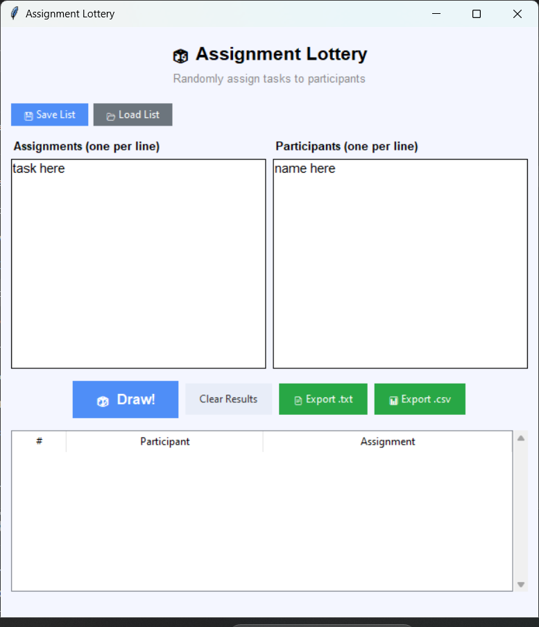

# 🎲 Assignment Lottery

A small desktop app that randomly hands out tasks to people. Paste in two lists, press **Draw**, and get a fair, shareable result.



**[Project page](https://cloudbv.github.io/assignment_lottery/)** · **[Download on itch.io](https://cloudbv.itch.io/assignment-lottery)**

## What it does

Assignment Lottery is built with Python and Tkinter. It works for chores, presentation topics, classroom roles, secret-santa style draws, or any time you need to split tasks without arguing about who gets what.

Type one assignment per line on the left and one participant per line on the right. The draw pairs each person with a task at random and shows the result in a table.

## Features

- **Fair random draw** using Python's `random` module
- **Save and load lists** as `.json` so recurring groups are one click away
- **Export results** as `.txt` or `.csv` (opens in Excel or Google Sheets)
- **Resizable window** with a scrollable results table
- **No dependencies**, only the Python standard library
- **File dialogs** for every save, load and export, with no hardcoded paths

## How assignments are handed out

| Situation | What happens |
| --- | --- |
| Enough tasks for everyone | Each participant gets a different task, no repeats |
| More participants than tasks | Tasks are shuffled, then repeat in a loop until everyone has one |

Blank lines and extra spaces are ignored. If either list is empty, the app asks you to fill it in.

## Run it

You need Python 3 with Tkinter. It is included with the standard Windows and macOS installers. On some Linux systems, install it with `sudo apt install python3-tk`.

```bash
git clone https://github.com/cloudbv/assignment_lottery.git
cd assignment_lottery
python3 assignment_lottery.py
```

## Using the app

1. Type your tasks in **Assignments** and your names in **Participants**, one per line.
2. Press **Draw!**. The results appear in the table below.
3. Press **Export .txt** or **Export .csv** to save them, or **Clear Results** to start over.
4. Use **Save List** and **Load List** to keep your lists for next time.

## Files the app creates

| File | Made by | Contents |
| --- | --- | --- |
| `.json` | Save List | Your assignments and participants, as typed |
| `.txt` | Export .txt | Numbered list, like `1. Name → Task` |
| `.csv` | Export .csv | Columns: `#`, `Participant`, `Assignment` |

## Author

Made by [cloudbv](https://cloudbv.itch.io/assignment-lottery).
